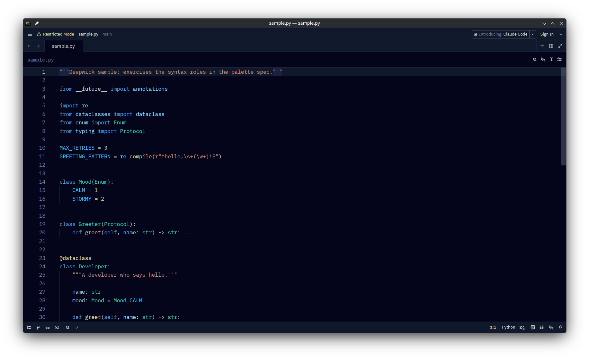

# Deepwick for Zed

A deep navy theme with Visual Studio 2022's syntax colors.

> Deepwick is an unofficial theme derived from
> [Polywick Blue](https://vscode.polywickstudio.net) by Polywick Studio (MIT).
> Not affiliated with Polywick Studio.



## Install

Copy the theme into Zed's user themes folder:

```sh
mkdir -p "${XDG_CONFIG_HOME:-$HOME/.config}/zed/themes"
cp themes/deepwick.json "${XDG_CONFIG_HOME:-$HOME/.config}/zed/themes/"
```

Then pick **Deepwick** with `theme selector: toggle`, or set it in
`settings.json`:

```json
{ "theme": "Deepwick" }
```

To work on the theme, use **zed: install dev extension** and choose this
folder.

## Notes

- Tree-sitter without semantic tokens: no capture distinguishes interfaces,
  enums, and structs from other types, so the Mint role appears only where a
  language server supplies semantic tokens. Macro definitions are captured as
  macros (Magenta) rather than preprocessor (Muted bold).
- Tree-sitter without per-language overrides: Python's `and`, `or`, `not`, `is`
  share the capture used for `typeof`/`new`, so they take the control-flow
  color; Python builtin types take the keyword color.
- Renamed files use Magenta.
- Zed's Python grammar captures `import`/`from` as plain keywords and
  docstrings as strings, so they render Blue and Orange.

Tested with Zed 0.223.3.

## License

MIT. See [LICENSE](LICENSE).
